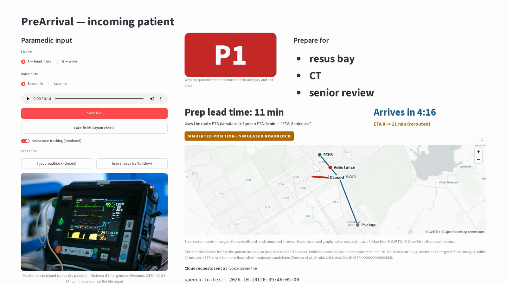

# PreArrival

Ambulance-to-ER handoff board for VisionForge at AICON'26. A saved English voice note and a monitor photo go to a cloud model live. A partial NEWS2 and a fixed table set the priority and the prepare-for list.



**AI reads, rules decide.** Cloud models (Groq: Whisper, Qwen vision, GPT-OSS) turn the voice note and the monitor photo into fields, each with an evidence quote. Plain code scores a partial NEWS2 (missing vitals stay missing) and looks up a fixed prepare-for table. The board flags values to confirm with the crew, and an optional simulated ambulance tracker shows the route and ETA, with roadblock rerouting that the crew must accept. Neither ever changes the triage.

Quick start: `pip install -r requirements.txt`, put `GROQ_API_KEY` in `.env`, run `python scripts/preflight.py a b` (expect READY), then `streamlit run app.py`.

Read these three before writing code:

- [docs/SRS.md](docs/SRS.md) — signed product spec. If this README and the spec disagree, the spec wins.
- [docs/PROJECT.md](docs/PROJECT.md) — requirements drill, acceptance bar, and the dropped CodeBlue idea.
- [docs/AICON.md](docs/AICON.md) — allocation email, module rules, schedule, and what was not on the public site.
- [docs/TIMELINE.md](docs/TIMELINE.md) — Saturday 10:30 through the Sunday 12:02 slot, with an owner on each block.

## Owners

| Track | Own these paths | Leave these alone |
|---|---|---|
| Speech and vision | `src/transcribe.py`, `src/vision.py`, `src/extract_note.py`, `fixtures/` | `src/news.py`, `src/decide.py`, `app.py` |
| Score and table | `src/news.py`, `src/decide.py`, `tests/` | `src/transcribe.py`, `src/vision.py`, `app.py` |
| Board | `app.py` | `src/news.py`, `src/decide.py`, `fixtures/` |
| Talk | `talk/` | everything under `src/` |

## Setup

```bash
python -m venv .venv
.venv\Scripts\activate
pip install -r requirements.txt
copy .env.example .env
```

Put `GROQ_API_KEY` in `.env`. That file is gitignored. Models are set in `src/groq_client.py` and can be overridden in `.env`.

Run the board with `streamlit run app.py` and open http://localhost:8501.

Before a demo, run `python scripts/preflight.py a b`. It checks the key and models, runs both fixtures live, and prints READY or the failing line. Don't run it in the two minutes before the slot, because the free-tier rate limit can slow the next call.

## Clock

The working schedule is [docs/TIMELINE.md](docs/TIMELINE.md).

Saturday 13:00 board with fake fields. Saturday 18:00 both fixtures live. Saturday 21:00 feature freeze. Saturday 23:00 submission pack. Sunday 10:30 two rehearsals on the presenting laptop and the phone hotspot.

Demo: Sunday 11 October 2026, 12:02–12:07, SEECS Lecture Hall.
